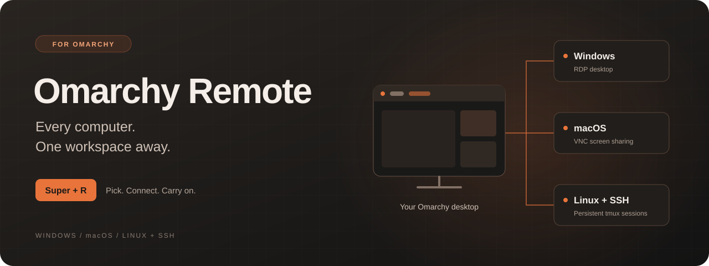

<p align="center">
  
</p>

<h1 align="center">Omarchy Remote</h1>

<p align="center">
  <b>Your Windows desktop. Your Mac. Your servers. Right inside <a href="https://omarchy.org">Omarchy</a>.</b><br>
  Pick a computer · open its workspace · carry on where you left off
</p>

<p align="center">
  
  
  
  
  <a href="#credits-and-licenses"></a>
</p>

<p align="center">
  <a href="#quick-start">Get started</a> ·
  <a href="#use">Shortcuts</a> ·
  <a href="#settings">Configure</a> ·
  <a href="#troubleshooting">Troubleshooting</a> ·
  <a href="#credits-and-licenses">Credits</a>
</p>

---

Remote computers should feel as close as your next workspace. **Omarchy Remote** puts your Tailscale computers in the top bar and a `Super + R` picker. Choose one and its desktop opens full size on its own workspace. `Super + Tab` brings you back; the remote connection stays open.

## A whole desk, one keyboard

<table>
  <tr>
    <td width="50%" valign="top">
      <h3>🖥️ Windows, at full resolution</h3>
      FreeRDP opens your desktop at your monitor’s real pixel size, with dynamic resizing and sharp text on HiDPI screens.
    </td>
    <td width="50%" valign="top">
      <h3>🍎 Your Mac, within reach</h3>
      The included lightweight VNC viewer supports Apple login, two-way clipboard and optional display matching.
    </td>
  </tr>
  <tr>
    <td valign="top">
      <h3>⌨️ Servers that remember your place</h3>
      SSH hosts get their own terminal workspace. Persistent tmux sessions let you disconnect and return to your work later.
    </td>
    <td valign="top">
      <h3>✨ At home in Omarchy</h3>
      Computers appear from Tailscale and your SSH config. Connect from the bar or the picker, and keep using your local Super shortcuts.
    </td>
  </tr>
</table>

<p align="center"><b>Discover automatically · connect in one click · keep passwords in your keyring</b></p>

> Built on [FreeRDP](https://www.freerdp.com), [libvncclient](https://libvnc.github.io) and SSH, with [Tailscale](https://tailscale.com) for private connectivity. Remote access must be enabled on each target computer.

## Quick start

1. **Run the guided setup** (adds the plugin, installs missing packages after asking, checks Tailscale, installs everything):
   ```bash
   bash <(curl -fsSL https://raw.githubusercontent.com/JeoCrypto/omarchy-remote/main/setup.sh)
   ```
   Prefer to read it first? Open [`setup.sh`](setup.sh). Or follow [Install](#install) by hand.
2. **Tailscale on every computer** you want to reach, signed in to the same account (`sudo tailscale up` here).
3. **Turn on remote access on each target.** Windows: Settings > System > Remote Desktop (requires an edition that supports hosting RDP, such as Pro). Mac: System Settings >
   General > Sharing > Screen Sharing; also enable Remote Login for the display-matching helper. Linux: an SSH server.
4. **Press `Super + R`**, pick a computer. The first time it asks for the user name and password once and saves the
   password in your keyring. After that it is one click.

If you added the plugin through the marketplace or `omarchy plugin add` and skipped step 1, the bar shows a
**Set up remote** chip. Click it to run the same guided setup.

## Requirements

- Omarchy (Hyprland + the Omarchy shell) and [Tailscale](https://tailscale.com), signed in
- `freerdp` (provides `sdl-freerdp3`), `libsecret` (`secret-tool`), `jq`, `openssh`
- To build the Mac viewer: `gcc`, `make`, `pkgconf`, `sdl3`, `libvncserver` (already on a stock Omarchy)
- On each Windows computer: an RDP host-capable edition (such as Pro), with Remote Desktop turned on. On each Mac: Screen Sharing turned on.

```bash
omarchy pkg add freerdp libsecret jq openssh gcc make pkgconf sdl3 libvncserver
```

## Install

**From a clone** (recommended; builds the Mac viewer and sets everything up):

```bash
git clone https://github.com/JeoCrypto/omarchy-remote.git && cd omarchy-remote
./install.sh --dry-run     # see exactly what it will do
./install.sh
```

**Through Omarchy's plugin manager** (the same repo, listed in the plugin marketplace):

```bash
omarchy plugin add https://github.com/JeoCrypto/omarchy-remote.git
cd ~/.config/omarchy/plugins/omarchy-remote && ./install.sh
```

The plugin only draws the bar chips and the `Super + R` picker; the helper programs come from `install.sh`, which
works from either location. `omarchy plugin update omarchy-remote` then pulls new versions (run `./install.sh` again
if the scripts changed).

The installer first lists what it will change and asks to continue (`--yes` skips the question). It checks the dependencies, builds `omarchy-vnc`, installs the scripts into `~/.local/bin`, installs
the shell plugin (bar chips and picker in one), and adds clearly marked blocks to `~/.config/hypr/hyprland.lua` and
`bindings.lua`. Every file it edits gets a timestamped backup, and if Hyprland rejects the result the old files are
restored.

Remove everything with `./uninstall.sh` (add `--purge` to also delete your computer list and saved passwords).

## Use

| | |
|---|---|
| **Super + R** | The picker, with one key per action (below) |
| **Bar chip** | Click a computer. Dim = offline, bright = online, lit = connected |
| **Super + F** | Fullscreen toggle. Normal windows behave as before; remote windows fill the monitor without losing sharpness |
| **Super + Shift + R** | Open the manager (below) |
| **Right-click a chip, or `d` in `Super + R`** | Disconnect: closes the window; the computer's own session keeps running |
| **Super + Tab / Super + 1-5** | Leave the remote workspace. The session stays connected |
| **Super + W** | Close the remote window (same as disconnecting) |

### The `Super + R` picker

A launcher in three steps. **Type** to search, press **Enter** to connect, press **→** for everything else.

| Where | Keys |
|---|---|
| **Computers** | Type to search · `↑` `↓` move · `Enter` connect · `→` more · click a row to connect · click `✕` on a connected one to disconnect · `Esc` close |
| **More** (`→`) | Every row shows its key: `c` connect (or go to the open desktop) · `s` plain ssh terminal · `t` tmux sessions · `d` disconnect · `p` set the password · `h` hide · `e` settings (the manager) · `←` back |
| **tmux sessions** | `Enter` open · `n` new (type the name) · `x` kill (asks `y / n`) · `X` kill all · `←` back |

The key legend is always shown at the bottom. For editing and testing in bulk, use the manager (`Super + Shift + R`).

**The first time** you open a Windows or Mac computer, a small terminal asks for the user name and password
(twice). It checks the login once, then saves the password in your keyring. After that it is one click.
If the check says the login was rejected, nothing is saved. Repeated failures can lock an account, so check first.

## The manager (`Super + Shift + R`)

A keyboard-driven screen, in the spirit of tmax: an fzf list of your computers
with status glyphs (`●` connected, `○` online, `·` offline, `★` starred), a preview pane that shows each computer's
**effective settings** (what you set, and what is just the built-in default), and gum menus to change them.

| Key (normal mode) | Does |
|---|---|
| `j` `k` `g` `G` | Move |
| `Enter` | Connect |
| `T` | **tmux**: open, create or kill sessions on the computer (Windows needs psmux) |
| `d` | **Disconnect** (closes the window; the computer's session keeps running) |
| `a` | **Add** a computer that is not on Tailscale (address, system, name, user, then its password) |
| `e` | Edit: name, user, client, UI scale, Mac fit, Command key, Mac display size, reset |
| `p` | Set or change the password (login is verified once before saving) |
| `t` | Test the saved login (asks first, one attempt) |
| `f` | Star (pin to the top) |
| `h` | **Hide / show** a computer (hidden ones leave the bar and `Super + R`, and stay in the manager, dimmed) |
| `x` | **Remove**: forgets the password and settings (you type `yes`). For a computer you added, it removes the computer itself |
| `M` | Mac display: show the mode, choose a size, restore now |
| `r` | Refresh status |
| `/` or `i` | Filter by typing; `Esc` returns to normal mode |
| `?` `q` | Help, quit |

The cached list appears instantly and live status replaces it a moment later. `remote-manage config` prints every
computer's effective settings in the terminal. It needs `fzf` and `gum`, which ship with Omarchy.

## SSH hosts and tmux

Everything in your `~/.ssh/config` with an explicit `Host` name (no wildcards) shows up too, as a terminal computer
with a `󰆍` glyph. If it is the same machine as one on your Tailscale, the SSH name is simply attached to it, so
nothing appears twice.

- **Click an SSH computer** (or press `Enter` on it in the manager): a terminal opens full size on its own workspace
  and runs `ssh -t <host>` with `tmux new-session -A -s main`, so you land in the same tmux session every time.
  If tmux is not installed on the other side you get a plain login shell, with a one-line note.
- **In `Super + R`**, press `→` on a computer, then `t`: `Enter` opens a session, `n` creates one, `x` kills one and
  `X` kills them all (each asks `y / n`).
- **Windows PCs** have no native tmux. If you install [psmux](https://docs.rs/psmux/latest/pmux) (a Windows tmux, on WinGet
  and Scoop) the same screens work for them; without it you get a plain PowerShell, and the sessions list says tmux is
  missing. Not tested on a real PC yet.
- **`T` in the manager** does the same with menus: open, create, kill one, or kill all. For a computer that is
  already open as a desktop, the session opens as an extra terminal next to it.
- From a script: `remote-sessions [list|kill|kill-all] <computer> [session]`.
- **Disconnect** closes the window; the tmux session keeps running on the computer, so you pick up exactly where you
  were. Right-click a chip, or press `d` in `Super + R` or the manager, and it closes every window of that workspace.
- Settings per computer (in the manager under `e`, or in `remote-computers.json`): `"tmux": "off"` for a plain shell,
  `"session": "work"` for another default session name.
- Needs key-based SSH login (`ssh-copy-id`), nothing else: no agent or daemon on the remote side except tmux itself.
  Homebrew and `/usr/local/bin` are added to the remote `PATH`, so tmux is found on a Mac too.

## The Omarchy menu

`Super + Space` > **Remote** gathers everything in one place (the installer adds it to
`~/.config/omarchy/extensions/omarchy-menu.jsonc`, in a marked block that `uninstall.sh` removes):

| Entry | Does |
|---|---|
| Connect to a computer | The `Super + R` picker |
| tmux sessions | Pick an online Mac, Linux or ssh computer, then open or create a tmux session |
| Manage computers | The manager (`Super + Shift + R`) |
| Add a computer | Add one that is not on Tailscale |
| Disconnect all | Close every remote window (sessions keep running on the computers) |
| Edit the computer list | Open `remote-computers.json` in your editor |
| Keys and help | Every key of the manager |

## Computers that are not on Tailscale

Tailscale machines appear by themselves. For anything else (a PC on your local network, a server with a public
address), press `a` in the manager and give it an address, a system and a user. It then behaves like the others, with
two differences: it is marked "added" in the manager, and its online state comes from a quick check that its
remote-access port answers (3389 for Windows, 5900 for macOS, 22 for Linux).
Without Tailscale there is no private tunnel: use these only on networks you trust, and prefer Tailscale for anything
reachable from the internet. Remove one with `x`, or hide a Tailscale machine you never use with `h`.

## Settings

Nothing is required. To name a computer or change how it behaves, edit `~/.config/omarchy/remote-computers.json`.
Entries are matched on `host`, the Tailscale machine name.

```json
[
  { "host": "office-pc", "label": "Office", "user": "alex" },
  { "host": "macbook",   "label": "Mac",    "user": "alex", "mac_size": "1600x900" }
]
```

| Field | Applies to | Meaning |
|---|---|---|
| `manual` | added by hand | `true` for a computer you added (needs `host` as an address and `os`) |
| `os` | added by hand | `windows`, `macos` or `linux` |
| `hidden` | all | `true` hides it from the bar and `Super + R` |
| `label` | all | Name shown in the bar and picker |
| `user` | Windows, Mac | Login name (filled in by the first-time prompt) |
| `client` | all | `freerdp` (Windows default), `vnc` (Mac default), `ssh` (Linux default) |
| `scale` | Windows | UI scale in percent. Default is your monitor's scale (200 on a 2x screen) |
| `fit` | Mac | `auto` (default), `contain`, `cover`, `stretch`. See below |
| `cmd` | Mac | `ctrl` (default: Ctrl+C becomes Command+C), `alt`, `none` |
| `mac_display` | Mac | `"off"` to never change the Mac's display |
| `mac_size` | Mac | Force a display mode such as `"1600x900"` instead of the closest match |
| `tmux` | Mac, Linux, SSH | `"off"` opens a plain shell instead of a tmux session |
| `session` | Mac, Linux, SSH | Default tmux session name (default `main`) |

Environment variables for troubleshooting: `REMOTE_DEBUG=1` (verbose FreeRDP log), `REMOTE_FREERDP_ARGS="..."`
(extra FreeRDP flags). Logs are in `$XDG_RUNTIME_DIR/remote-desktop-<host>.log`.

## How it works

```
Tailscale ──► remote-desktop-status ──► bar chips + Super+R picker   (Omarchy shell plugins, QML)
                                  │
click ─► remote-desktop ──► workspace "name:<host>" ──► client window
                                  ├─ Windows: sdl-freerdp3  (/size = monitor px, /scale-desktop = monitor scale)
                                  ├─ Mac:     omarchy-vnc   (+ mac-display over SSH)
                                  └─ Linux:   ssh in a terminal
Hyprland: one generic rule for windows of class omarchy-remote-*; gapless workspace per host;
          Super+F -> remote-fullscreen (compositor fullscreen the client is not told about)
```

Details that matter:

- **Sharpness.** FreeRDP's built-in dynamic resize sends the logical size when a window goes fullscreen, which makes
  Windows draw too small and stretched on HiDPI screens. This project instead gives remote windows a tiled, gapless
  layout and `Super + F` uses Hyprland's `fullscreen_state` (compositor fullscreen with the client told it is not
  fullscreen), so the real pixel size is always sent.
- **Windows key.** Both Super keys are remapped to F24 for the remote side, otherwise every Super shortcut would
  also open the Windows Start menu. H.264 is turned off because FreeRDP's VAAPI decoder can stall the window.
- **Mac.** Apple's VNC server cannot resize the Mac's desktop, so `omarchy-vnc` scales the picture to fit. To make
  the Mac *look* like the Windows windows, a small helper (`mac-display`, compiled on the Mac with Apple's own
  command line tools, only CoreGraphics) switches the display to the closest HiDPI mode when you connect and restores
  it when you disconnect. Its changes last for the login session only, so a logout or reboot always reverts them.
  Restore by hand any time: `ssh <mac> '~/.local/bin/mac-display restore'`.
- **Fit modes (Mac).** `auto` stretches only when the window and the Mac's screen differ by less than 4% (not
  noticeable), otherwise it keeps proportions and shows thin bars.

## Keeping Windows computers reachable

Tailscale only helps while a computer is awake. `windows/keep-awake.ps1` makes a Windows PC stay reachable while it
is plugged in: it turns on Tailscale's *Run unattended* (so signing out doesn't drop it) and sets sleep and hibernate
to *never* on AC power, leaving battery settings alone. The original values are saved on the PC. Run it over SSH:

```bash
ssh <pc> "$(cat windows/keep-awake.ps1)"
```

A sleeping or shut-down PC cannot be woken by Tailscale. Wake-on-LAN needs another always-on device on the same
local network and is unreliable over Wi-Fi; keeping the PC awake while plugged in is simpler.

## Security and privacy

- Passwords are stored with libsecret (GNOME keyring): service `omarchy-remote`, name = host. They are passed to
  FreeRDP and `omarchy-vnc` through standard input, so they never appear in `ps`, shell history or logs.
- It connects to individual machines over Tailscale. It does **not** bridge or route networks, so it never exposes
  a network that one machine happens to be connected to.
- Windows certificates are trusted on first use (`/cert:tofu`). Use Tailscale ACLs to limit who can reach what.
- The Mac helper runs over SSH with your key and only changes the display mode; it never touches files elsewhere.

## Troubleshooting

- **"offline" but the machine works:** Tailscale's flag can lag. The launcher also accepts live traffic or a direct
  path and confirms with a real ping before giving up.
- **"wrong password":** run `remote-desktop-setup <host>` again.
- **Pointer too big on Windows:** at 200% scaling Windows draws a 64 px arrow. Lower Windows' pointer size
  (`HKCU\Control Panel\Cursors\CursorBaseSize`) if you prefer a smaller one.
- **Mac interface too big or small:** set `mac_size` (larger numbers give a smaller interface). Modes are listed by
  `ssh <mac> '~/.local/bin/mac-display list'`.
- **A Windows window closed by itself:** if someone unlocks or uses that computer's own screen, Windows hands the
  session to the physical console and disconnects remote viewers. Click the chip again to take it back.
- **A Windows computer drops off Tailscale when its session is signed out:** turn on Tailscale's *Run unattended*
  setting on that PC so it stays connected without anyone signed in.
- **Windows scale ignored (UI tiny):** a custom display scale (Settings > Display > Scale > Custom) overrides what the
  client requests. Remove it and sign in again so Windows reads the client's scale.
- **Chips look stale after an update:** `omarchy restart shell`.

## Development

```bash
make            # build omarchy-vnc
make test       # headless login checks against a local test server (right/wrong password, unreachable)
```

`test/testserver.c` is a small libvncserver server that prints the input it receives; `omarchy-vnc --selftest`
sends synthetic mouse, key and clipboard events to it.

## Contributing

Issues and pull requests are welcome at <https://github.com/JeoCrypto/omarchy-remote>. Please run `make test` first.

## Credits and licenses

**omarchy-remote was developed by JeoCrypto.** It stands on the work of many others:

Built on FreeRDP (Apache-2.0), libvncclient / LibVNCServer (GPL-2.0-or-later), SDL3 (zlib), Tailscale, Hyprland
and Omarchy.

- `src/omarchy-vnc.c`: **GPL-2.0-or-later** (it links libvncclient). See `COPYING.GPL-2.0`.
- Everything else (scripts, plugins, Hyprland rules, `mac/mac-display.c`, tests): **MIT**. See `LICENSE`.


---

<p align="center">
  <b>More from JeoCrypto, for Omarchy</b><br>
  <a href="https://github.com/JeoCrypto/omarchy-golden-gate-theme">Golden Gate theme</a> ·
  <a href="https://github.com/JeoCrypto/omarchy-glass-dock">Glass Dock</a> ·
  <a href="https://github.com/JeoCrypto/omarchy-snap-layouts">Snap Layouts</a>
</p>

<p align="center"><sub>Made by JeoCrypto · Scripts and plugins: MIT · VNC viewer: GPL-2.0-or-later</sub></p>
